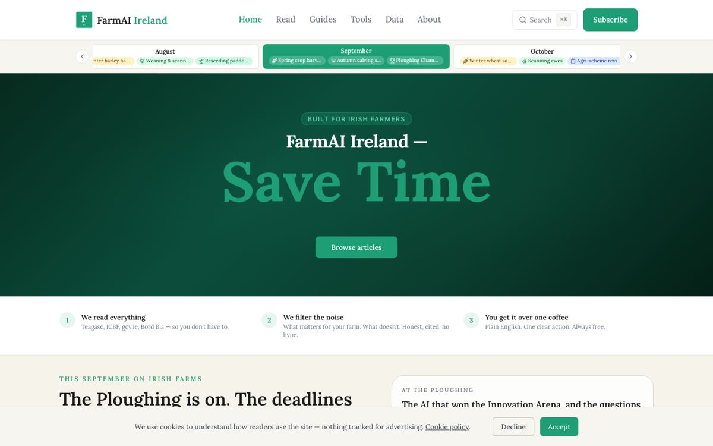

# FarmAI Ireland

**Irish farm advice is scattered across a dozen institutions and the farm press, and most AI coverage is hype. We believe FarmAI is the first free, independent editorial that reads it all for Irish farmers and turns it into one cited, plain-English action.**

## Why I built it

Teagasc, the Department, ICBF, Bord Bia and the farm papers all publish things a farmer needs to know. Nobody has time to read them all, least of all in calving season. FarmAI reads them, checks the source, and says what it means this week. It also tests a bigger idea: a small independent publisher can own a niche when listening, drafting and checking run as an engine and a person makes the final call.

## What's under the hood

- **Content listening.** Official sources, farm news and weather warnings are read every day and ranked by what matters to a farmer.
- **A content engine with gates.** Topics are scored, drafted with primary Irish sources, and checked for accuracy, voice and SEO before a person publishes.
- **Built to be found.** Every piece is structured for search engines and AI answers, and real search data feeds back into what gets written next.
- **One engine, many niches.** Sources, calendar, audience and voice live in config. A new sector or country is a config swap, not a rebuild.

## Where it stands

Live at [farmai.ie](https://farmai.ie): articles, guides, honest tool reviews, a farming calendar and free data tools. Source: private.

---

Built by John Robinson · [Stillbound.ai](https://stillbound.ai)
